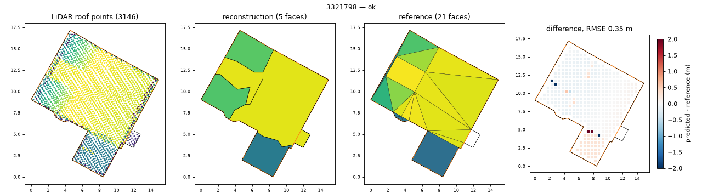
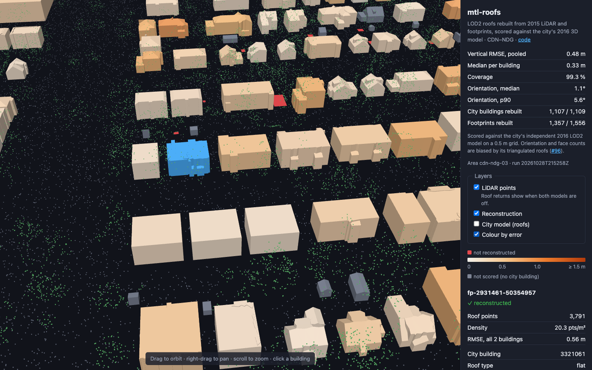
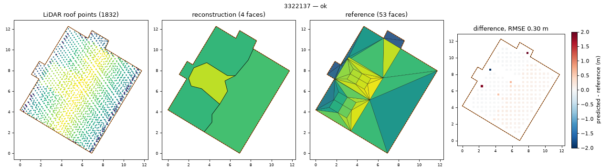
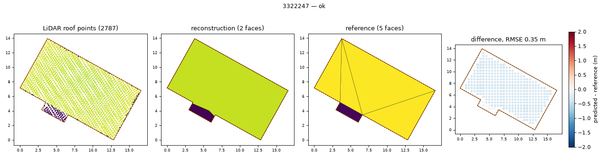
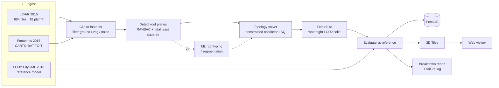

# mtl-roofs

[](https://github.com/grigorybaluev/mtl-roofs/actions/workflows/ci.yml)
[](https://github.com/grigorybaluev/mtl-roofs/actions/workflows/eval-smoke.yml)
[](https://codecov.io/gh/grigorybaluev/mtl-roofs)
[](LICENSE)

**Reconstructs LOD2 building roofs for Montréal from open aerial LiDAR and building
footprints, and evaluates every building against the city's own 3D building model.**

Most roof-reconstruction demos stop at a picture. This one is built around the
measurement: Montréal publishes both a 2015 aerial LiDAR survey *and* a 2016 LOD2
CityGML model of the same buildings, so every reconstructed roof can be scored
against an independent reference — vertical RMSE, plane-orientation error and
coverage, broken down by roof type, building size and point density, with a
per-building failure log rather than a cherry-picked gallery.



*A typical mixed roof, chosen by rule as the one closest to the median error of its
roof type: input LiDAR, reconstruction, the city's reference model (triangulated), and
the height difference on the 0.5 m evaluation grid (red: reconstruction too high,
blue: too low).*

**Status:** the classical pipeline and the evaluation are complete for the v0 study
area, and the **[web viewer](https://grigorybaluev.github.io/mtl-roofs/)** shows all of
it: every reconstruction, the failures, the city's model and the LiDAR, coloured by
error, with each building's metrics a click away.

[](https://grigorybaluev.github.io/mtl-roofs/)

## Results

Classical pipeline on the v0 study area, **CDN–NDG tile 03**: 1,556 building
footprints, 1,109 reference buildings, 28.7 M LiDAR points.

| Metric | Result | Notes |
|---|---:|---|
| Vertical RMSE | **0.48 m** | all grid cells pooled; median per building **0.33 m** |
| Plane orientation error | **1.1°** median · 5.6° p90 | matched plane pairs; see [#96](https://github.com/grigorybaluev/mtl-roofs/issues/96) |
| Footprint coverage | **99.3%** | share of the reference roof the reconstruction covers |
| Reference buildings reconstructed | **1,107 of 1,109** | 1 grouped in the reference, 1 not watertight |
| Footprints reconstructed | **1,357 of 1,556** | 105 with no detectable plane, 93 with too few points, 1 not watertight |

| Roof type | Buildings | RMSE | Median building RMSE | Orientation, median |
|---|---:|---:|---:|---:|
| pitched | 508 | 0.39 m | 0.30 m | 1.3° |
| mixed | 253 | 0.46 m | 0.35 m | 0.7° |
| flat | 348 | 0.57 m | 0.35 m | 0.0° |

**What the numbers say**

- **Pitched roofs are the strongest case** at 0.39 m RMSE. Flat roofs score worst on
  RMSE while their orientation agrees almost exactly, because both the solver and the
  reference level them: their error is in height, not slope.
- **Large buildings are the weak spot.** The four over 1,000 m² reach 1.13 m RMSE,
  three times the typical building, and their coverage drops to 93%.
- **Dense LiDAR helps**: 0.38 m RMSE at ≥ 20 pts/m² against 0.52 m at 10–20 pts/m².
  The 42 buildings below 10 pts/m² are too few to read a trend from.
- **The 2015 → 2016 gap did not bite here.** No building's LiDAR sits more than
  0.74 m from the reference as a median (the flag is at 1.5 m), so the raw and
  "temporally clean" numbers are identical on this tile.

Every metric is a *disagreement with the city's model*, not an error against ground
truth: the reference is itself a photogrammetric product. Definitions, matching rules
and aggregation are in [`docs/evaluation.md`](docs/evaluation.md), written before the
code.

### Example buildings

The median case for each roof type, picked by
[`scripts/readme_figures.py`](scripts/readme_figures.py), not by eye. The worst 20
buildings, each with a diagnosis, are rendered by `mtl-roofs report` into the
failure gallery.




### Reproduce

Every number above comes from these commands, after the Quickstart below:

```bash
mtl-roofs reconstruct -a cdn-ndg-03   # every footprint, with its status, into PostGIS (~14 min)
mtl-roofs evaluate    -a cdn-ndg-03   # every reference building scored
mtl-roofs report      -a cdn-ndg-03   # breakdown tables and the failure gallery
mtl-roofs export-scene -a cdn-ndg-03  # the viewer's scene (released as viewer-data-*.zip)
```

They write to `data/processed/cdn-ndg-03/`: `reconstructions.csv` and `buildings.csv`
(one row per footprint and per building, failures included), `report/breakdown.md`
(every metric by roof type, size and point density), and `report/gallery/gallery.md`,
**the failure gallery**: the worst buildings by RMSE, each with a diagnosis.

## How it works

1. **Clip and filter.** LiDAR points are clipped to each footprint and filtered by
   classification; ground points nearby fix the floor height.
2. **Detect roof planes.** RANSAC finds which points belong to a plane; a total
   least-squares fit over all inliers then refines it, and near-coplanar planes are
   merged.
3. **Solve the topology.** Adjacent planes are refined jointly by Levenberg–Marquardt
   with gated regularity priors — level ridges, footprint-aligned slopes, level flat
   roofs — so ridges, hips and valleys meet consistently
   ([ADR 0006](docs/adr/0006-topology-solver-priors.md),
   [spec](docs/topology-solver.md)).
4. **Extrude.** The roof partition is lifted onto its planes and closed with vertical
   walls and a floor into a watertight, manifold LOD2 solid.
5. **Evaluate.** Reference buildings are assigned to footprints spatially (the
   footprint layer has no building id, [ADR 0005](docs/adr/0005-reconstruct-per-footprint-score-per-building.md)),
   and both surfaces are sampled on a common 0.5 m grid.

## Engineering highlights

- **Fetching tiles that have no working URL.** The city's per-tile download links
  are dead, and the archives are 20–28 GB. `data fetch` reads their ZIP64 central
  directories over HTTP range requests and streams only the members a study area
  needs, about 190 MB per km², each verified against a pinned SHA-256.
- **Watertight on real terrain.** Two failure classes found in the batch run and
  fixed at the root: on a hillside the floor sat above the downhill eaves (now the
  5th percentile of the ground, [#88](https://github.com/grigorybaluev/mtl-roofs/pull/88)),
  and at vertices where four faces alternate high/low an edge was shared four times
  (now split into a manifold, [#89](https://github.com/grigorybaluev/mtl-roofs/pull/89)).
- **Failures are rows, not omissions.** Every footprint gets a status
  (`ok`, `no-planes`, `too-few-points`, `not-watertight`, …), every unscored building
  a reason, and the report renders the worst cases with a diagnosis.
- **Evaluation as a regression guard.** CI runs `eval-smoke` on 20 real building
  fixtures against a committed baseline; a PR may change the algorithm or the
  baseline, never both, so every metric movement is attributable.
- **Decisions written down.** Six ADRs, metric definitions written before their
  implementation, `mypy --strict`, conventional commits, release-please.

## Limitations

- **The reference is not ground truth.** It is a 2016 photogrammetric model, so
  every number is a disagreement between two products; LiDAR and reference are also
  a few months apart, and the temporal flag only catches whole-building changes, not
  an extension or a new rooftop unit.
- **Only roofs are scored.** The reference's walls are synthetic, extrapolated from
  the roof edge to below grade.
- **Footprints and buildings don't map one to one.** 60% of reference buildings share
  a footprint with a neighbour, so a footprint is reconstructed once and scored per
  building; 795 footprints have no reference building at all.
- **Face-count agreement is held back.** The reference roofs are triangulated (92% of
  their polygons are triangles), so comparing face counts against them measures the
  tessellation, not the topology. It returns once reference triangles are merged into
  planar faces ([#96](https://github.com/grigorybaluev/mtl-roofs/issues/96)). The same
  issue biases plane matching towards large reference polygons, so the orientation
  numbers are computed on a subset.
- **199 footprints are not reconstructed.** 198 of them have no reference building in
  the city's model either, and a median of 52 LiDAR points against 1,970 for the ones
  that reconstruct; the one `not-watertight` footprint is the only failure that costs a
  scored building.

## Pipeline



## Quickstart

Needs [pixi](https://pixi.sh) and Docker. No Homebrew, and no local PostgreSQL —
see [`CLAUDE.md`](CLAUDE.md) for why.

```bash
git clone https://github.com/grigorybaluev/mtl-roofs && cd mtl-roofs
cp .env.example .env

pixi install                 # conda-forge: PDAL, GDAL, PROJ, GEOS, the lot
pixi run test                # unit tests
pixi run db-up               # PostGIS in Docker, waits for healthcheck

pixi run mtl-roofs data areas                  # study areas
pixi run mtl-roofs data plan   -a cdn-ndg-03   # what would be downloaded, and what is pinned
pixi run mtl-roofs data fetch  -a cdn-ndg-03   # ~1.07 GB, verified against the manifest
pixi run mtl-roofs data verify -a cdn-ndg-03   # re-check what is on disk, offline
pixi run mtl-roofs data load   -a cdn-ndg-03   # footprints + reference model into PostGIS
```

Every artefact is checked against a SHA-256 pinned in `data/manifest.yaml`. An existing
file that fails verification is re-downloaded once; if it still fails, the command exits
non-zero rather than letting a corrupt tile into the pipeline.

`data fetch` does **not** download the city's 20 GB archives. It reads their ZIP64
central directories over HTTP range requests and streams only the tiles the study
area needs — about 190 MB per km². The per-tile URLs the city advertises are all
dead, so this is the only working route to a single tile.

### Tasks

| Task | What it does |
|---|---|
| `pixi run lint` / `format` | ruff check / ruff format + autofix |
| `pixi run typecheck` | `mypy --strict src` |
| `pixi run test` | unit tests with coverage |
| `pixi run test-integration` | needs `db-up` |
| `pixi run eval-smoke` | metrics on `tests/fixtures/`, the regression guard |
| `pixi run db-up` / `db-down` | PostGIS container |
| `pixi run -e viewer viewer-dev` / `viewer-build` | Vite dev server / production build |

## Data and attribution

All three datasets are published by the **Ville de Montréal** under
[CC BY 4.0](https://creativecommons.org/licenses/by/4.0/):

> Contains information licensed under CC BY 4.0 from the Ville de Montréal
> (LiDAR aérien 2015; Bâtiments 3D 2016 — Maquette LOD2; Bâtiments 2D 2016).
> Portions of the 2D building layer derive from 2007 aerial photography
> © Communauté métropolitaine de Montréal.

Everything is processed in **EPSG:2950** (NAD83(CSRS) / MTM zone 8), metres,
**CGVD28** elevations. Coverage, licences, file sizes, checksums, and the pitfalls
found while verifying them are in [`docs/data-sources.md`](docs/data-sources.md).

**No data is committed to this repository.** `data/` is git-ignored; the only
exception is `tests/fixtures/`, which holds a handful of tiny building clips. The
figures in `docs/img/` are renderings derived from the datasets above, under the same
attribution.

## Scope

- **v0 — "one neighbourhood, honest numbers":** one neighbourhood, classical pipeline
  only, full evaluation report, viewer deployed. Done.
- **v1 — "ML + borough scale":** ML roof typing with ablations against the classical
  pipeline on identical metrics, scaled to a full borough.

[Roadmap](docs/roadmap.md) · [Milestones](https://github.com/grigorybaluev/mtl-roofs/milestones) ·
[Architecture decisions](docs/adr/) · [Contributing](CONTRIBUTING.md)
